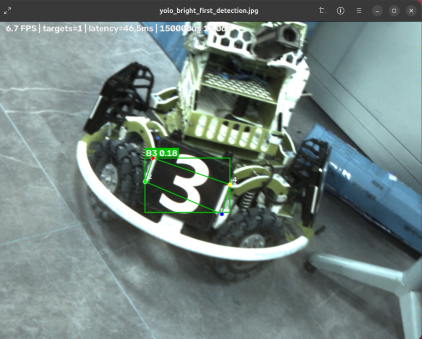
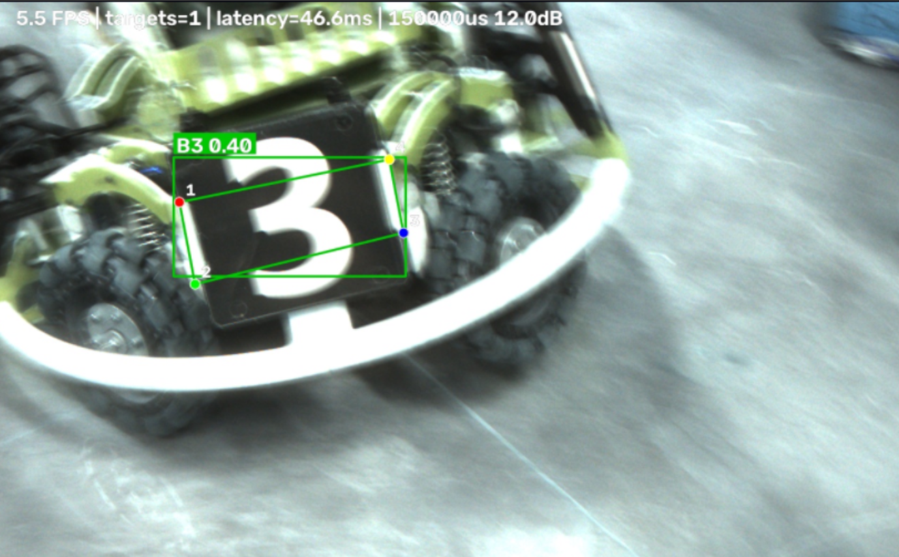
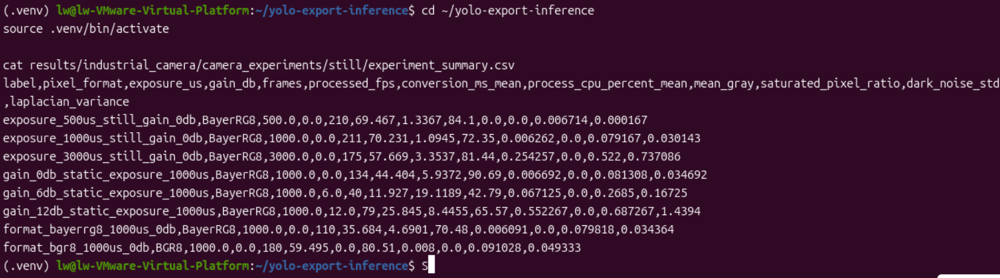

# 工业相机取流与 YOLO 装甲板实时识别

本项目完成第三次算法组作业：使用海康机器人 MVS USB3 工业相机连续取流，
测试曝光、增益、BayerRG8/BGR8 与异常资源释放，再把实时图像送入已有的
YOLO26n 装甲板四关键点模型，绘制检测框、类别、置信度和四个预测关键点。

> 代码已在安装了海康 MVS 的 Ubuntu 虚拟机和 MV-CA016-10UC 相机上实机运行。
> 本文数值来自相机输出和程序生成的 JSON/CSV；低曝光漏检结果也按实际情况保留。

## 1. 已实现功能

- 通过官方 MVS C 动态库和 Python `ctypes` 连接 USB3 Vision 相机；
- 枚举设备，显示型号、序列号和固件版本；
- 自动记录 MVS SDK 版本、Linux 发行版、Python 与 OpenCV 版本；
- 连续取流，关闭自动曝光/自动增益，设置并回读曝光、增益、ROI 和像素格式；
- 支持相机原生 `BayerRG8` 与 `BGR8`；
- `BayerRG8` 优先使用 SDK 的 `MV_CC_ConvertPixelTypeEx`；当前环境该接口返回
  `0x80000500`，程序会保留原始 Bayer 数据并回退到 OpenCV 转换，同时记录耗时和警告；
- 严格保持一次成功的 `MV_CC_GetImageBuffer` 对应一次 `MV_CC_FreeImageBuffer`；
- 按逆序释放取流、设备、句柄和 SDK，并保存每一步的错误码与结果；
- 自动执行 500/1000/3000 μs 曝光、0/6/12 dB 增益和两种像素格式实验；
- 保存原始帧、BGR 帧、短视频、JSON/CSV 汇总、亮度、饱和像素比例、
  暗部噪声、清晰度代理值、FPS、CPU 和格式转换耗时；
- 加载 `.pt`、`.onnx` 或 `.torchscript`，进行真实相机实时装甲板识别；
- 绘制检测框、类别、置信度、四个模型预测关键点、框中心点和处理延迟；
- 保存结果视频、逐帧 CSV、推理汇总和相机资源清理日志；
- 通过 `fault-test` 制造真实取流超时及不支持格式注入，检查资源是否归零；
- 提供 OpenCV `cv::Mat` 浅拷贝、深拷贝和 Bayer 转换示例。

模型仍为课程提供的六类装甲板权重：`B1, B2, B3, R1, R2, R3`，每个目标
输出 4 个二维关键点。本次不训练模型。

## 2. 实验环境

推荐在与课堂一致的机器上运行：

| 项目 | 要求 |
|---|---|
| 操作系统 | Ubuntu 虚拟机（Python 和 MVS 均运行在虚拟机内） |
| 架构 | x86_64 |
| Python | 3.14.4，使用项目内 `.venv` |
| 相机 | 海康机器人 MV-CA016-10UC，序列号 `00L28498186` |
| 相机固件 | `V1.6.3 201222 551351` |
| 相机 SDK | 海康机器人 MVS Linux SDK 4.9.0.3 |
| MVS 动态库 | `/opt/MVS/lib/64/libMvCameraControl.so` |
| 图像接口 | OpenCV 5.0.0.93 |
| 推理后端 | ONNX Runtime 1.31（CPU） |
| 推理设备 | CPU |

项目默认模型是 `models/best.onnx`，使用 ONNX Runtime CPU 推理。Windows 开发机
没有连接工业相机，因此 Windows 侧只运行离线测试；取流和识别实验在 Ubuntu
虚拟机内完成。

### 实机结果摘要

静止场景实测数据如下。饱和像素按灰度 `>= 250` 统计：

| 条件 | 帧数 | FPS | 转换 ms/帧 | 程序 CPU % | 平均灰度 | 饱和比例 | 暗部噪声 |
|---|---:|---:|---:|---:|---:|---:|---:|
| 500 μs / 0 dB | 210 | 69.467 | 1.3367 | 84.10 | 0.000000 | 0.000000 | 0.006714 |
| 1000 μs / 0 dB | 211 | 70.231 | 1.0945 | 72.35 | 0.006262 | 0.000000 | 0.079167 |
| 3000 μs / 0 dB | 175 | 57.669 | 3.3537 | 81.44 | 0.254257 | 0.000000 | 0.522000 |
| 1000 μs / 6 dB | 40 | 11.927 | 19.1189 | 42.79 | 0.067125 | 0.000000 | 0.268500 |
| 1000 μs / 12 dB | 79 | 25.845 | 8.4455 | 65.57 | 0.552267 | 0.000000 | 0.687267 |
| BayerRG8 / 1000 μs / 0 dB | 110 | 35.684 | 4.6901 | 70.48 | 0.006091 | 0.000000 | 0.079818 |
| BGR8 / 1000 μs / 0 dB | 180 | 59.495 | 0.0000 | 80.51 | 0.008000 | 0.000000 | 0.091028 |

现场照明明显不足：500–3000 μs 时平均灰度始终低于 `0.6`。提高曝光和增益会
抬高灰度，但五组固定参数的 YOLO 对比都发生漏检；这是本实验保留的真实异常结果。
正常识别样例为 `B3`，一处置信度约 `0.18`，移动演示中一处为 `0.40`；四个
关键点都来自模型输出。移动演示视频为 1440×1080、7 FPS、162 帧，约 23 秒，
OpenCV 验证可以正常打开。







## 3. 准备 MVS 和 Python 环境

### 3.1 确认 MVS 能出图

先安装海康官方 Linux MVS。安装后在终端检查：

```bash
find /opt/MVS -name MvCameraControl.h
find /opt/MVS -name 'libMvCameraControl.so*'
lsusb
lsusb -t
```

USB 链路应显示 `5000M` 左右，而不是 `480M`。如果 `480M`，先更换 USB3 线、
直连主机并检查供电。随后打开 MVS 客户端，确认相机能够正常出图。运行本程序前
关闭 MVS 客户端，避免设备被独占。

如果 SDK 不在默认位置，设置：

```bash
export MVS_SDK_LIBRARY=/你的/MVS/lib/64/libMvCameraControl.so
```

### 3.2 安装 Python 依赖

```bash
cd ~/yolo-export-inference
python3 -m venv .venv
source .venv/bin/activate
python -m pip install --upgrade pip
pip install -r requirements.txt
```

如果 OpenCV 需要看桌面窗口，系统还要安装：

```bash
sudo apt install -y libgl1
```

### 3.3 准备模型

仓库已有：

```text
models/best.pt
models/best.onnx
models/best.torchscript
```

直接使用 `models/best.onnx` 即可。若文件丢失，把课程参考材料中的 `best.pt`
放到 `models/best.pt`，再执行：

```bash
python export.py --weights models/best.pt --formats onnx --imgsz 640
```

## 4. 最短运行流程

以下 `YOUR_SERIAL` 必须替换成自己的相机序列号。先执行 `list` 获取。

```bash
# 0. 查看命令帮助
python camera_cli.py --help

# 1. 找到相机
python camera_cli.py list

# 2. 实时预览，q 或 Esc 退出
python camera_cli.py preview --serial YOUR_SERIAL

# 3. 预览固定曝光和增益
python camera_cli.py preview \
  --serial YOUR_SERIAL \
  --pixel-format BayerRG8 \
  --exposure-us 1000 \
  --gain-db 0
```

Ubuntu 没有图形桌面或通过 SSH 运行时，加 `--no-display`。这样程序仍会取流和
保存文件，但不会打开窗口。

## 5. 四项相机实验

### 5.1 曝光实验

固定机位、镜头、光圈、光源和增益为 0 dB。在画面里放置装甲板，先拍静止组：

```bash
python camera_cli.py experiment \
  --serial YOUR_SERIAL \
  --scene still \
  --duration 3 \
  --no-display
```

再拍运动组。运行后按提示依次进行每个曝光条件；在每个 3 秒片段中人手缓慢、
匀速地水平移动装甲板，速度和距离尽量保持一致：

```bash
python camera_cli.py experiment \
  --serial YOUR_SERIAL \
  --scene moving \
  --duration 3 \
  --no-display
```

程序会执行 500、1000、3000 μs，并保存对应的原图、BGR 图、短视频和统计 JSON。
`laplacian_variance` 只是清晰度代理值，不能单独证明拖影长度；最终结论要结合
真实图片观察。

曝光越长，传感器在一帧内累积光的时间越长，画面通常越亮；同一运动目标在曝光
期间移动的距离也越长，因此运动拖影越明显。

### 5.2 增益实验

上面命令同时执行 0、6、12 dB，固定曝光 1000 μs，目标保持静止。程序统计：

```text
saturated_pixel_ratio = 灰度值 >= 250 的像素数 / 总像素数
dark_noise_std        = 灰度值 < 64 区域的标准差
```

增益提高会放大传感器信号和已有噪声，所以画面可能变亮，但噪声和过曝也会增加。
过曝会丢失亮部细节，增益并不能替代更合理的曝光和补光。

### 5.3 BayerRG8 / BGR8 性能实验

同一命令也测试两种格式，固定 1000 μs、0 dB：

- `BayerRG8`：相机每个像素输出一个 CFA 采样，每帧约 `W×H` 字节；程序调用
  MVS SDK 转 BGR，每帧变成 `W×H×3` 字节；
- `BGR8`：相机直接输出三通道彩色图，每帧约 `W×H×3` 字节；
- 若相机拒绝 BGR8，程序会明确报错，不把它伪装成“相机原生 BGR8”。

结果 JSON 同时记录：

```text
requested_pixel_format
actual_camera_pixel_format
conversion
conversion_ms_mean / conversion_ms_p95
processed_fps / interval_fps_mean
process_cpu_percent_mean
```

BGR8 传输量通常是 BayerRG8 的 3 倍，可能受到 USB 带宽和主机拷贝限制；但 Bayer
流程还要做去马赛克，不能只凭理论带宽判断哪个端到端更快。必须看现场实测。

### 5.4 错误处理与内存释放

先编译课堂 `mat_memory` 示例：

```bash
cmake -S camera_examples -B build-memory -DBUILD_MVS_CAPTURE=OFF
cmake --build build-memory -j2
./build-memory/mat_memory
```

它会展示 `cv::Mat` 浅拷贝共享地址、`clone()` 深拷贝，以及 Bayer 转 BGR。

运行两个异常测试：

```bash
python camera_cli.py fault-test \
  --serial YOUR_SERIAL \
  --mode timeout

python camera_cli.py fault-test \
  --serial YOUR_SERIAL \
  --mode bad-format
```

`timeout` 会在取流启动后设置软件触发但不发送触发，让 `MV_CC_GetImageBuffer`
真实超时。`bad-format` 会先取得真实帧，再在应用层把像素类型强制改成
`0xDEADBEEF`，验证程序拒绝未知字节格式，同时仍在 `finally` 中归还 SDK 缓冲区。

日志保存在：

```text
results/industrial_camera/logs/fault_timeout.json
results/industrial_camera/logs/fault_bad-format.json
```

检查其中：

```json
"expected_fault_observed": true,
"released": {
  "leased_buffer_clear": true,
  "grabbing_clear": true,
  "opened_clear": true,
  "handle_clear": true
},
"sdk_finalized": true
```

`expected_fault_observed` 为 `true` 才表示确实触发了预期异常；若相机未连接、
触发设置失败或没有出现超时，程序会以非零状态退出，不能把该日志当作成功记录。

仓库还提供一键完成上述检查并打包实验结果的脚本：

```bash
bash scripts/finalize_camera_tests.sh ~/yolo-export-inference
```

## 6. YOLO 实时识别

最小运行命令：

```bash
python camera_cli.py yolo \
  --serial YOUR_SERIAL \
  --model models/best.onnx \
  --pixel-format BayerRG8 \
  --exposure-us 1000 \
  --gain-db 0 \
  --duration 20
```

窗口中可看到：

- 装甲板检测框；
- 类别 `B1/B2/B3/R1/R2/R3`；
- 置信度；
- 模型输出的 4 个关键点（1 红、2 绿、3 蓝、4 黄）；
- 框中心十字；
- 当前 FPS、目标数量、从图像接收完成到推理结果绘制的处理延迟、曝光与增益。

按 `q` 或 Esc 提前退出。无桌面时：

```bash
python camera_cli.py yolo \
  --serial YOUR_SERIAL \
  --model models/best.onnx \
  --duration 20 \
  --no-display
```

结果默认保存为：

```text
results/industrial_camera/yolo/yolo_live.mp4
results/industrial_camera/yolo/yolo_live_first_frame.jpg
results/industrial_camera/yolo/yolo_live_first_detection.jpg
results/industrial_camera/yolo/yolo_live_detections.csv
results/industrial_camera/yolo/yolo_live_report.json
```

首帧截图用于保留漏检或异常画面，首次检测截图用于展示正常识别效果。CSV 中
每一行是一个检测目标，包含类别、置信度、框坐标、框中心坐标和四个关键点。

### 自动比较曝光/增益对识别的影响

```bash
python camera_cli.py yolo-impact \
  --serial YOUR_SERIAL \
  --model models/best.onnx \
  --duration 3 \
  --no-display
```

它会分别测试 500/1000/3000 μs 和 0/6/12 dB，保存每个条件的带标注视频、
逐帧检测 CSV 和汇总 JSON：

```text
results/industrial_camera/yolo_impact/yolo_impact_summary.json
```

请在同一个装甲板、同一距离和角度、同一光源下测试。若出现漏检、误检、类别错误
或关键点偏移，保留原结果，不删除失败帧，并在实验记录中分析。

## 7. 输出目录

```text
results/industrial_camera/
├── camera_experiments/
│   ├── still/
│   │   ├── exposure_500us_still_gain_0db_raw.png
│   │   ├── exposure_500us_still_gain_0db_bgr.jpg
│   │   ├── exposure_500us_still_gain_0db.mp4
│   │   ├── exposure_500us_still_gain_0db.json
│   │   ├── ...
│   │   ├── experiment_summary.csv
│   │   └── experiment_summary.json
│   └── moving/
├── yolo/
├── yolo_impact/
├── logs/
└── capture/
```

视频已由 `.gitignore` 排除，应作为作业附件提交。代表性原始图、结果截图、JSON/CSV
需要提交到 Git，作为真实实验记录。

## 8. 实验记录

完整的现场记录在 [docs/experiment-record.md](docs/experiment-record.md)，包含：

- 相机型号、序列号、固件版本；
- Ubuntu、MVS、OpenCV、Python、ONNX Runtime 版本；
- ROI、曝光、增益、光源、镜头和工作距离；
- 模型路径、格式、类别和推理设备；
- 每一组的 FPS、CPU、转换时间和图像指标；
- 至少一组正常识别与一组异常识别；
- 异常日志和资源释放结果。

## 9. 代码结构与主要功能

```text
camera_cli.py                  相机实验和 YOLO 实时推理统一入口
mvs_camera/sdk.py              MVS C 动态库、ctypes 结构体、错误码
mvs_camera/camera.py           相机生命周期、配置、取帧、Bayer 转换、释放
mvs_camera/metrics.py          图像质量、FPS、CPU、运行时统计
armor_core.py                  已有模型的预处理、解码、NMS、框和关键点绘制
inference.py                   已有 PT/ONNX/TorchScript 通用推理后端
camera_examples/mat_memory.cpp  Mat 深浅拷贝与 Bayer 转换演示
camera_examples/mvs_capture.cpp 课堂风格的 C++ 取流示例
tests/test_camera_core.py      无相机也能运行的离线测试
docs/experiment-record.md      现场实验数据、失败样例与问题分析
docs/yolo-export-previous.md   上一份模型导出作业说明
```

主要数据流：

```text
MVS 曝光
→ GetImageBuffer 借用 SDK 缓冲区
→ 校验宽高/格式/帧长
→ BayerRG8 由 SDK 转 BGR，或直接使用原生 BGR8
→ NumPy 深拷贝
→ FreeImageBuffer 归还缓冲区
→ YOLO 前处理/推理/解码/NMS
→ 绘制框、类别、置信度、4 关键点
→ 显示/录像/CSV
→ StopGrabbing/CloseDevice/DestroyHandle/Finalize
```

## 10. 运行自检

没有相机时可以在 Windows 或 Ubuntu 执行：

```bash
python -m unittest discover -s tests -v
```

预期 13 项测试全部通过。它检查 SDK 常量与结构体尺寸、未知格式仍归还缓冲区、
`enPixelType=0` 和损坏帧长度的安全恢复、Bayer 转换回退、Get/Free 配对、
BGR/Bayer 帧复制与转换、FPS、图像指标、中心坐标和命令行参数。

## 11. 常见问题

| 现象 | 处理方法 |
|---|---|
| `LoadMvsLibrary` 失败 | 安装 MVS，检查位数/架构，设置 `MVS_SDK_LIBRARY` |
| `MV_CC_OpenDevice` 失败 | 关闭 MVS 客户端；检查 USB3、供电、udev 权限 |
| `MV_CC_EnumDevices` 为 0 | `lsusb`、`lsusb -t`，确认不是 USB2 链路 |
| 找不到曝光或增益节点 | 先设置 `ExposureAuto=Off`、`GainAuto=Off`，并确认不是触发模式 |
| SDK 帧格式返回 `0x00000000` | 若宽度、高度和帧长度有效，程序会按相机回读格式恢复并写入警告；帧长度不匹配时仍拒绝猜测 |
| 请求 BGR8 失败 | 相机可能只支持 BayerRG8；保留失败记录，改用 Bayer 流程 |
| Bayer 图像颜色异常 | 确认返回的是 `BayerRG8`，不要强行当作 BGR；本程序用 SDK 转换 |
| `--no-display` | SSH 或无桌面环境必须使用，录像仍会正常保存 |
| 检测框延迟越来越大 | 使用最新帧策略；降低相机目标帧率或缩小 ROI，避免队列堆积 |
| 视频无法播放 | 用 OpenCV `mp4v` 生成；必要时安装 FFmpeg 转 H.264 后再提交 |
| 识别漏检或关键点偏移 | 记录原图、曝光、增益、模糊和过曝情况，不修改失败结果 |

## 12. 提交前检查

- [ ] `python camera_cli.py list` 能找到自己的相机；
- [ ] 完成 still/moving 两组曝光实验；
- [ ] 完成 0/6/12 dB 增益实验；
- [ ] 完成 BayerRG8 和 BGR8 实际 FPS、CPU、转换耗时记录；若 BGR8 不受支持，
      保留失败日志并记录 BayerRG8 转换流程；
- [ ] 完成 timeout 和 bad-format 两个清理测试；
- [ ] 实时 YOLO 程序能连续运行并显示框、置信度和 4 个关键点；
- [ ] 保存 20 秒左右、可正常播放的实时识别演示视频；
- [ ] 填写完成 `docs/experiment-record-final.md`；
- [ ] 提交代表性图片、CSV/JSON、代码和 README；
- [ ] 视频作为作业附件单独提交，单个不超过 100 MiB。

仓库和分支的 Git/PR 操作按课程要求执行；只有真实实验完成并核对链接后，才能说
本次作业已经全部验收完成。
