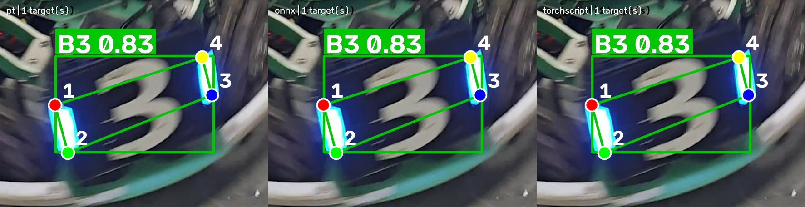
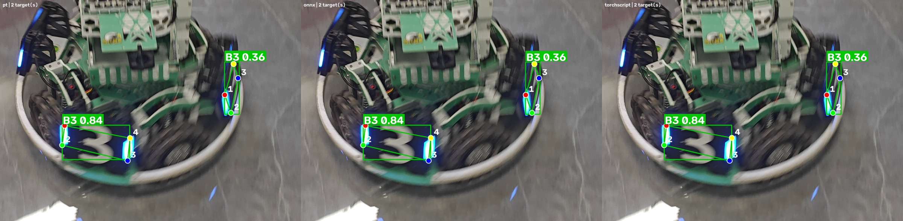
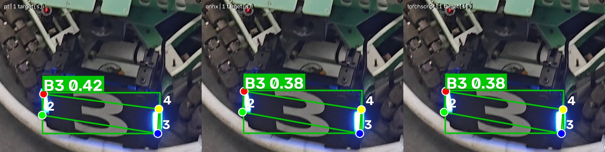

# YOLO 装甲板模型导出、推理与性能对比

> 社团培训第二次作业

把上一次作业使用的 YOLO26n 装甲板四关键点模型 `best.pt` 导出为 **ONNX** 与
**TorchScript**，用同一段自己拍摄的装甲板视频、同样的参数分别推理，并对
模型大小、推理耗时、检测数量、检测效果和关键点偏差做定量对比。

本项目所有实验均在 **CPU** 上完成，没有训练或修改模型权重。

## 1. 本次完成的内容

* 把 `best.pt` 导出为 `.onnx`（opset 17）和 `.torchscript` 两种非 PyTorch 原生格式；
* 编写统一的推理脚本 `inference.py`，按文件扩展名自动选择推理后端：
  * `.pt` → Ultralytics + PyTorch；
  * `.onnx` → **ONNX Runtime 原生推理**（前处理、解码、NMS 全部自己实现，不依赖 PyTorch）；
  * `.torchscript` → Ultralytics + TorchScript 运行时；
* 用同一段 4K 视频（611 帧）分别跑 PT 与 ONNX，保存带检测框、类别、置信度和
  **4 个模型预测关键点**的结果视频；
* 编写 `benchmark.py`：等间隔抽取测试帧 → 预热 → 多轮交替测量 → 统计耗时、
  检测数量、与 PT 的匹配率和关键点偏差，自动生成对比表格和对比图。

## 2. 模型版本与导出格式

| 项目 | 值 |
|---|---|
| 模型 | YOLO26n-pose 装甲板四关键点模型（课程统一提供的 `best.pt`） |
| 参数量 / 计算量 | 2,447,934 参数 / 5.6 GFLOPs |
| 类别 | `B1, B2, B3, R1, R2, R3` 共 6 类 |
| 关键点 | `kpt_shape = [4, 2]`，每个目标 4 个二维角点 |
| 输入尺寸 | `1 × 3 × 640 × 640` |
| 量化方式 | FP32（未量化） |

导出结果（`results/export_report.json`）：

| 格式 | 文件 | 大小 | 说明 |
|---|---|---|---|
| PyTorch | `models/best.pt` | 5.62 MiB | 原始权重 |
| ONNX | `models/best.onnx` | 9.68 MiB | opset 17，输入 `images [1,3,640,640]`，输出 `output0 [1,18,8400]` |
| TorchScript | `models/best.torchscript` | 9.94 MiB | `torch.jit.trace` 导出的静态图 |

ONNX 输出只有 **18 个通道**，可以这样拆开理解：

```
[0:4]      -> 检测框 cx, cy, w, h
[4:10]     -> 6 个类别的分数（模型内部已做 sigmoid）
[10:18]    -> 4 个关键点的 x, y
8400       -> 80×80 + 40×40 + 20×20 三个特征图的锚点数之和
```

`inference.py` 里的 `decode_pose_output()` 就是按这个结构把原始输出解码成检测框和关键点，
再用 `nms_class_aware()` 做按类别的 NMS。ONNX 文件比 PT 大，是因为计算图里保存了
完整算子定义和常量，而不仅仅是权重。

导出命令：

```powershell
python export.py --weights models/best.pt --formats onnx torchscript --imgsz 640
```

## 3. 运行环境

| 项目 | 值 |
|---|---|
| 操作系统 | Windows 11（AMD64） |
| Python | 3.14.6 |
| 推理设备 | **CPU**：AMD Ryzen 9 8945HX，16 GB 内存 |
| 显卡 | NVIDIA RTX 5060 Laptop 8 GB（当前环境安装的是 CPU 版 torch，未使用） |
| PyTorch | 2.14.1+cpu |
| Ultralytics | 8.4.175 |
| ONNX / ONNX Runtime | 1.23.2 / 1.31.0 |
| OpenCV / NumPy | 5.0.0 / 2.5.4 |
| 线程数 | 对比实验统一 12 线程（PyTorch 与 ONNX Runtime 相同） |

> 机器上有独立显卡，但当前虚拟环境里的 `torch` 是 CPU 版本
> （`torch.cuda.is_available()` 为 `False`），因此本次全部使用 CPU 推理。
> TensorRT 需要 CUDA 版 PyTorch 和 TensorRT 运行时，在 Python 3.14 下配置成本较高，本次未做。

## 4. 模型权重准备

仓库已包含三个模型文件（共约 25 MiB，未使用 Git LFS）：

```
models/best.pt           # 课程参考材料中下载的原始权重
models/best.onnx         # 本项目导出
models/best.torchscript  # 本项目导出
```

如果要从头复现，把课程提供的 `best.pt` 放到 `models/best.pt`，然后执行第 2 节的导出命令即可，
导出脚本会自动在同目录生成 `best.onnx` 和 `best.torchscript`。

## 5. 安装依赖与运行

### 5.1 安装

```powershell
cd D:\code\yolo-export-inference
python -m venv .venv
.\.venv\Scripts\activate
pip install -r requirements.txt
```

如果 PowerShell 提示禁止运行脚本，先执行：

```powershell
Set-ExecutionPolicy -Scope Process Bypass
```

### 5.2 三种格式分别推理

```powershell
# 原始 PyTorch
python inference.py --model models/best.pt --source data/robomaster.mp4 --out-scale 0.5

# ONNX Runtime
python inference.py --model models/best.onnx --source data/robomaster.mp4 --out-scale 0.5

# TorchScript
python inference.py --model models/best.torchscript --source data/robomaster.mp4 --out-scale 0.5
```

默认参数：`--conf 0.25 --iou 0.7 --imgsz 640 --max-det 30`，与上一次作业一致。
常用附加参数：

| 参数 | 作用 |
|---|---|
| `--out-scale 0.5` | 4K 输入输出成 1080p，减小文件体积（默认 1.0 保持原分辨率） |
| `--save-csv` | 导出逐帧检测明细 CSV（框坐标 + 4 个关键点坐标） |
| `--save-frames 3` | 保存若干张带标注的结果截图 |
| `--max-frames 30` | 只处理前 N 帧，用于快速调试 |
| `--threads 12` | 指定 ONNX Runtime 线程数（`inference.py` 中该参数只影响 ORT） |

也可以直接推理单张图片：

```powershell
python inference.py --model models/best.onnx --source data/frame.jpg
```

注意图片要用**未标注的原始画面**；拿已经画过框和关键点的截图再去推理，
标注本身会盖住装甲板特征，置信度会明显下降。

### 5.3 性能对比

```powershell
python benchmark.py --frames 120 --repeat 5 --warmup 12 --threads 12
```

只想快速看一眼流程、不覆盖正式结果时，加 `--out-dir` 换个目录：

```powershell
python benchmark.py --frames 20 --repeat 2 --warmup 5 --out-dir results/_quick
```

### 5.4 结果保存在哪里

| 输出 | 位置 |
|---|---|
| 结果视频 | `results/pt_pred.mp4`、`results/onnx_pred.mp4`、`results/torchscript_pred.mp4` |
| 逐帧检测明细 | `results/*_detections.csv` |
| 单次推理统计 | `results/*_stats.json` |
| 三种格式左右对比图 | `results/compare_frame*.jpg` |
| 单模型标注截图 | `results/sample_<格式>_frame*.jpg` |
| 基准测试明细 | `results/benchmark.json`、`results/benchmark_frames.csv` |
| 基准测试汇总表 | `results/benchmark.md` |

> 视频文件体积较大（每个约 45 MiB），已加入 `.gitignore`，需要时用上面的命令重新生成。

## 6. 测试视频

沿用上一次作业自己拍摄的原始视频，保证两次作业的测试数据一致：

| 项目 | 值 |
|---|---|
| 拍摄地点 | 水建学院 **D414 实验室** |
| 拍摄设备 | Redmi K70 手机 |
| 分辨率 / 帧率 | 3840×2160 @ 60 FPS |
| 时长 / 帧数 | 10.2 秒 / 611 帧 |
| 拍摄方式 | 手持横屏，绕着机器人缓慢移动，距离和角度持续变化 |
| 主要目标 | 正对镜头的蓝色 3 号装甲板（B3），侧面有 2 号装甲板（B2） |

把视频放到 `data/robomaster.mp4`（该目录下的视频不会被提交到 Git）。

## 7. 结果截图

下面三张图是同一帧在三种格式下的结果，每个目标都画出了检测框、类别、置信度，
以及**由模型预测得到的 4 个角点**（1 红、2 绿、3 蓝、4 黄，并连成四边形）。







第 267 帧的画面最清楚：三种格式都检出同一个 B3，置信度都是 0.83，框和 4 个角点完全重合。
4 个关键点（1 红、2 绿、3 蓝、4 黄）落在蓝色装甲板"3"字的四个角上，
并连成四边形，可以看出它们来自模型预测，而不是检测框的四个角。

## 8. 性能对比

### 8.1 基准测试（120 帧，5 轮，12 线程，CPU）

测试方法：等间隔抽取 120 帧 → 每个模型预热 12 帧 → 五轮测量且每轮轮换顺序 →
计时只包含"前处理 + 推理 + 后处理"，不含视频解码和写盘。

| 对比项目 | 原始 `.pt` | 导出 `.onnx` | 导出 `.torchscript` |
|---|---|---|---|
| 模型格式 | PyTorch | ONNX | TorchScript |
| 模型文件大小 | 5.62 MiB | 9.68 MiB | 9.94 MiB |
| 平均耗时 | **20.75 ms** | 21.65 ms | 35.29 ms |
| 中位数耗时 | 20.06 ms | 20.85 ms | 35.09 ms |
| P95 耗时 | 26.94 ms | 28.62 ms | 47.06 ms |
| 检测目标数（120 帧） | 111 | 111 | 111 |
| 含检测帧数 | 80 | 79 | 79 |
| 与 PT 结果匹配率 | 100% | 96.40% | 96.40% |
| 关键点平均偏差 | — | 0.92 px | 0.92 px |

这一轮 PT 反而比 ONNX 快 4%，和后面 8.2 的波动放在一起看才有意义。

### 8.2 重复测量的波动：PT 和 ONNX 到底差多少

同一台机器、同一段视频、同样参数，不同时间跑的 5 次结果（单位 ms/帧）：

| 测试规模 | PT | ONNX | ONNX 相对 PT |
|---|---|---|---|
| 60 帧 × 3 轮 | 30.66 | 28.55 | −6.9% |
| 90 帧 × 3 轮（旧版测量方法） | 35.77 | 38.85 | +8.6% |
| 20 帧 × 2 轮（快速试跑） | 18.94 | 21.32 | +12.6% |
| 120 帧 × 5 轮（第一次） | 26.22 | 24.92 | −5.0% |
| 120 帧 × 5 轮（第二次） | 20.75 | 21.65 | +4.3% |

ONNX 相对 PT 的差值在 **−7% 到 +13% 之间来回跳**，平均约 +3%，也就是基本持平。
连 PT 自己的绝对耗时都在 18.9～35.8 ms 之间变化，说明这个差距主要来自
笔记本的 CPU 调频、后台程序和温度，而不是格式本身。

**所以本项目不宣称"ONNX 更快"。** 这个只有 2.4M 参数的小模型在桌面 CPU 上，
两个运行时本来就差不多；ONNX 的价值在部署侧（见第 10 节），而不是这几毫秒。

### 8.3 整段视频推理（611 帧，4K 输入，1080p 输出）

| 对比项目 | 原始 `.pt` | 导出 `.onnx` |
|---|---|---|
| 含检测帧数 | 419（68.6%） | 426（69.7%） |
| 检测目标总数 | 591 | 603 |
| B3 | 506 个，平均置信度 0.661 | 513 个，平均置信度 0.661 |
| B2 | 81 个，平均置信度 0.445 | 86 个，平均置信度 0.447 |
| B1 | 4 个，平均置信度 0.290 | 4 个，平均置信度 0.326 |
| 平均纯推理耗时 | 23.90 ms/帧 | 22.01 ms/帧 |
| 平均前处理耗时 | 1.93 ms/帧 | 5.64 ms/帧 |
| 平均后处理耗时 | 2.21 ms/帧 | **0.55 ms/帧** |
| 端到端帧率 | 15.3 FPS | 15.9 FPS |
| 结果视频 | `results/pt_pred.mp4` | `results/onnx_pred.mp4` |

> 端到端帧率包含 4K 解码、绘图和 1080p 编码，受磁盘和 OpenCV 影响很大，
> 所以不要把 15 FPS 当作模型速度。模型的真实速度看"纯推理耗时"那一行。
> 这里也是单次全片运行的结果，同样存在 8.2 节那样的 ±10% 波动。

### 8.4 线程数的影响

同一张图反复推理 30 次，只测 ONNX Runtime 的 `session.run()`：

| 线程数 | 默认（0） | 4 | 8 | 12 | 16 |
|---|---|---|---|---|---|
| 平均耗时 | 24.40 ms | 27.41 ms | 19.30 ms | **18.61 ms** | 24.25 ms |

线程不是越多越快：本机是 16 核，开 12 个线程比默认和 16 个线程都快。
因此 `benchmark.py` 把 PyTorch 和 ONNX Runtime 都固定到 12 线程，
避免"一边默认 16 线程、另一边 12 线程"造成不公平。

## 9. 实际识别表现、遇到的问题与处理

### 9.1 识别表现

* 整段视频 611 帧中，约 69% 的帧能检测到目标，主要是因为拍摄时镜头在机器人周围移动，
  部分时间装甲板不在画面里或严重侧对镜头；
* 正对镜头、距离适中的 B3 最稳定，平均置信度 0.66；
* 侧面装甲板 B2 置信度明显偏低（0.44 左右），说明大角度下特征变弱；
* 只在少数帧出现的 B1 置信度只有 0.29～0.33，属于勉强越过 0.25 阈值的检测；
* 全片检测到的都是蓝色装甲板（B 开头的类别），视频中红色装甲板没有清晰出现在镜头里。

### 9.2 PT 与 ONNX 的差异

把两次全片推理的 603 个 ONNX 框和 591 个 PT 框逐帧按"同类 + IoU ≥ 0.5"配对：

| 结果 | 数量 | 置信度范围 |
|---|---|---|
| 两边都检出且能配上 | 578 | — |
| 只有 PT 检出 | 13 | 0.25～0.42，平均 0.30 |
| 只有 ONNX 检出 | 25 | 0.25～0.50，平均 0.33 |

净差 12 个（603 − 591）。未配对的全是**贴着 0.25 阈值**的低分框，
没有任何一个是高置信度目标被漏掉或误判类别。

原因：导出后卷积、sigmoid 等算子的浮点累加顺序变化，使分数在第 4~5 位小数上出现差异，
刚好跨过阈值的目标就会出现"有/没有"的区别。这不是模型损坏，也不是数据不一致。

处理方式：保留真实结果并如实记录，没有手动删除 ONNX 多出来的框，也没有调高阈值去"凑一致"。

### 9.3 关键点位置

匹配上的目标，ONNX 与 PT 的 4 个关键点平均只差 **0.92 像素**（3840 宽的画面上），
这来自坐标还原过程中的浮点误差，肉眼看不出来。

### 9.4 遇到的问题与解决

| 问题 | 原因 | 处理 |
|---|---|---|
| 第一次解码 ONNX 输出报"通道数不匹配" | 把 `kpt_shape=(4,2)` 的 4 个点误当成 8 个点，重复乘 2 | 改为按关键点个数 `4` 计算，`4+6+4×2=18` 通道对上 |
| Python 3.14 下导出 TorchScript 有 `FutureWarning` | PyTorch 官方提示 `torch.jit.trace` 在 3.14+ 可能失效 | 目前导出和推理都正常，记录风险，改用 `torch.export` 是后续方向 |
| 不同轮次测得的耗时波动 5～10 ms | 每帧之间夹着 4K 视频解码，干扰 CPU 缓存 | 改为先把测试帧缓存成 JPEG，再在内存里反复推理，并轮换模型顺序 |
| 默认线程下 ONNX 反而比 PyTorch 慢 | ONNX Runtime 默认线程数不是最优 | 实测后统一固定 12 线程，两边条件一致 |
| TorchScript 推理比 PT 慢很多 | TorchScript 侧重脱离 Python 部署，不做桌面 CPU 指令优化 | 如实记录，不作为推荐格式 |
| 4K 结果视频约 45 MiB | mp4v 编码在 4K 下体积大 | 用 `--out-scale 0.5` 输出 1080p；视频不提交 Git |
| 用已标注的结果截图再推理时检测不到目标 | 框、关键点和标签盖住了装甲板图案，特征被破坏 | 用原始视频/原始画面测试；实测干净的第 248 帧可正常检出 2 个 B3 |
| 快速试跑 `benchmark.py` 覆盖了正式结果 | 默认输出到 `results/` | 试跑时加 `--out-dir results/_quick`，正式结果用 120 帧 × 5 轮重跑 |

## 10. 对几种模型格式的理解

| 格式 | 本质 | 优点 | 缺点 | 本次结论 |
|---|---|---|---|---|
| `.pt` | PyTorch 权重 + 模型结构 | 调试方便，可直接 `model.predict()` | 依赖 PyTorch 环境和 Python | 开发、验证阶段的首选 |
| `.onnx` | 与框架无关的静态计算图 | 通用性强，ONNX Runtime / OpenVINO / TensorRT 都能吃；部署选择多 | 需要自己写前后处理；动态形状要额外导出 | **本次推荐**，速度与 PT 基本持平，可移植性最好 |
| `.torchscript` | PyTorch 的序列化图 | 仍然使用 PyTorch 算子，C++ 也能加载 | 生态绑定 PyTorch，桌面端不算快 | 能跑通，适合留作对比 |
| `.engine` (TensorRT) | NVIDIA GPU 上的引擎 | 在 N 卡上通常最快 | 需要 CUDA 环境，与显卡/驱动强绑定 | 当前 CPU 环境无法做，跳过 |

一句话总结：**导出不是为了"一定更快"，而是为了让模型脱离训练框架、在别的环境里也能跑。**
这个只有 2.4M 参数的模型在桌面 CPU 上两种运行时基本打平；
换成更大的模型、嵌入式设备或 GPU/TensorRT，才更容易看出差距。

## 11. 项目结构

```
yolo-export-inference/
├── README.md
├── requirements.txt
├── .gitignore
├── export.py            # PT -> ONNX / TorchScript 导出 + 校验 + 导出报告
├── armor_core.py        # letterbox 前处理、ONNX 解码、NMS、坐标还原、画框画关键点
├── inference.py         # 统一推理入口，支持 .pt / .onnx / .torchscript，输出视频/CSV/截图
├── benchmark.py         # 预热 + 多轮交替测量 + 检测对齐 + 对比图和汇总表
├── models/
│   ├── best.pt
│   ├── best.onnx
│   └── best.torchscript
├── data/                # 原始视频（不提交 Git）
└── results/
    ├── export_report.json
    ├── benchmark.json / benchmark.md / benchmark_frames.csv
    ├── compare_frame*.jpg
    ├── sample_<格式>_frame*.jpg
    ├── pt_pred_detections.csv / onnx_pred_detections.csv
    └── *_stats.json
```

## 12. 主要代码功能说明

* `export.py`
  * `export_one()`：调用 `YOLO.export()` 导出指定格式；
  * `check_onnx()`：用 `onnx.checker` 校验计算图，并打印输入输出张量形状；
  * 自动记录文件大小、SHA256 和导出耗时到 `results/export_report.json`。
* `armor_core.py`
  * `letterbox()` / `preprocess()`：等比缩放 + 居中填充到 640×640，再归一化成 NCHW；
  * `decode_pose_output()`：把 `(1,18,8400)` 拆成框、类别、关键点；
  * `nms_class_aware()`：按类别做 NMS；
  * `scale_detections()`：把 640 尺度坐标还原到原视频分辨率；
  * `draw_detections()`：画框、类别、置信度和 4 个关键点。
* `inference.py`
  * `OnnxRuntimePredictor`：原生 ONNX Runtime 推理路径（不使用 PyTorch）；
  * `UltralyticsPredictor`：PT / TorchScript 的统一封装；
  * 支持视频、图片输入，支持 CSV 明细、代表帧截图和统计 JSON。
* `benchmark.py`
  * 缓存测试帧、预热、多轮轮换测量；
  * 与 PT 逐帧对齐，统计匹配率与关键点偏差；
  * 自动生成左右对比图和 Markdown 汇总表。
