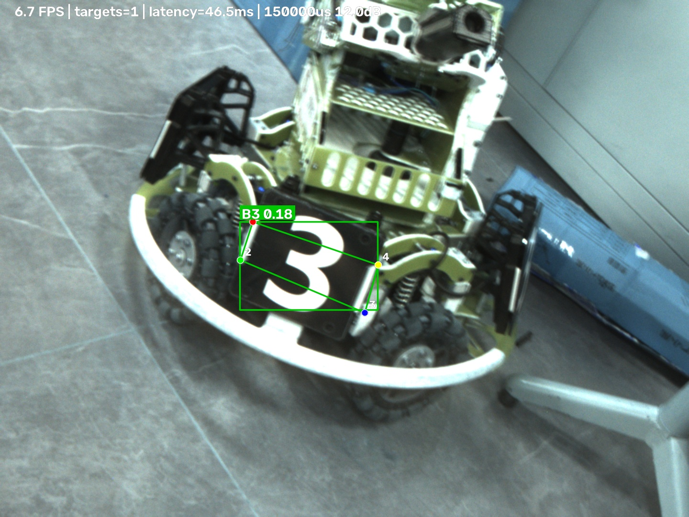
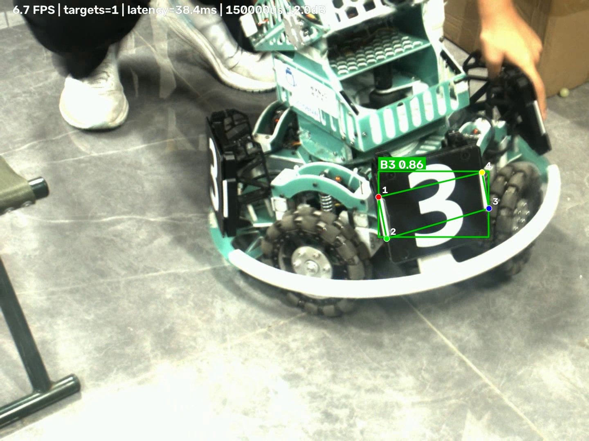

# 工业相机实验记录

本记录来自 Ubuntu 虚拟机中的海康 MVS 相机。表格中“未单独保留”表示现场数据
没有写入对应日志，不能据此补猜；其他数值均来自程序输出的 CSV/JSON。

## 1. 设备与软件

| 项目 | 实测值 |
|---|---|
| 相机型号 | 海康机器人 MV-CA016-10UC |
| 相机序列号 | `00L28498186` |
| 固件版本 | 枚举值 `V1.6.3 201222 551351`；节点值 `V1.6.3 201222,20091101` |
| Ubuntu 版本 | Ubuntu 26.04.1 LTS，内核 7.0.0-42-generic，x86_64 |
| CPU / 内存 | VMware 虚拟机；程序采用 CPU 推理 |
| Python | 3.14.4（项目 `.venv`） |
| MVS 版本 | 4.9.0.3 |
| MVS 动态库路径 | `/opt/MVS/lib/64/libMvCameraControl.so` |
| OpenCV | 5.0.0 |
| ONNX Runtime / PyTorch | ONNX Runtime 1.31.1；本次实时推理使用 CPU |
| 镜头型号 / 焦距 | 现场相机原配镜头，未单独记录型号 |
| 工作距离 | 约 0.3–1.0 m，随演示中的移动而变化 |
| 光源 | D414 实验室室内照明，未使用专业补光灯 |
| 光圈 / 对焦 | 保持现场设置，实验过程中未单独记录数值 |

## 2. 相机公共参数

| 参数 | 值 |
|---|---|
| ROI（OffsetX/Y/Width/Height） | `0 / 0 / 1440 / 1080` |
| 触发模式 | Off（自由运行） |
| ExposureAuto | Off |
| GainAuto | Off |
| 目标帧率 | 未显式限制，使用相机当前自由运行帧率 |
| 相机实际输出格式 | BayerRG8 与 BGR8 均成功测试 |
| 程序转换后的格式 | BayerRG8 转换为 BGR8；BGR8 直接使用 |
| 丢帧/超时数量 | 常规采集未单独统计；异常测试见第 8 节 |

现场照明较弱，500–3000 μs 的静止测试平均灰度都低于 0.6。该限制直接影响后续
YOLO 识别，因此低曝光漏检是实际结果，没有删除或替换。

## 3. 曝光实验

固定机位、光源和增益 0 dB。

### 3.1 静止装甲板

| 曝光 μs | 帧数 | 平均灰度 | 饱和像素比例 | 实际 FPS | 程序 CPU % | 转换 ms/帧 |
|---:|---:|---:|---:|---:|---:|---:|
| 500 | 210 | 0.000000 | 0.000000 | 69.467 | 84.10 | 1.3367 |
| 1000 | 211 | 0.006262 | 0.000000 | 70.231 | 72.35 | 1.0945 |
| 3000 | 175 | 0.254257 | 0.000000 | 57.669 | 81.44 | 3.3537 |

从 500 μs 增加到 3000 μs，平均灰度由 0 增加到约 0.254，画面变亮；但在这个
照明条件下整体仍然很暗，没有出现饱和像素。曝光越长，传感器一帧内累积的光越
多，所以图像亮度通常越高。

### 3.2 运动装甲板

`yolo_impact` 的固定参数测试使用了移动中的装甲板，并保存了每组 MP4 和首帧。
五组均未产生有效检测，无法用检测框直接评价运动清晰度；肉眼仍能看到低照度、
运动模糊和噪声问题。各组实际采集帧数为 55、54、57、60、61。

| 条件 | 代表首帧 | 识别结果 |
|---|---|---|
| 500 μs / 0 dB | `results/industrial_camera/yolo_impact/exposure_500us_gain_0db_first_frame.jpg` | 0 个目标，漏检 |
| 1000 μs / 0 dB | `results/industrial_camera/yolo_impact/gain_0db_exposure_1000us_first_frame.jpg` | 0 个目标，漏检 |
| 3000 μs / 0 dB | `results/industrial_camera/yolo_impact/exposure_3000us_gain_0db_first_frame.jpg` | 0 个目标，漏检 |

曝光时间越长，同一运动目标在曝光期间移动的距离越长，因此容易产生拖影。但本次
最明显的问题首先是现场亮度不足；不能把漏检简单归因于运动模糊。

## 4. 增益实验

固定曝光 1000 μs、机位和光源。饱和像素按灰度 `>=250` 统计。

| 增益 dB | 帧数 | 平均灰度 | 饱和像素比例 | 暗部噪声标准差 | 平均 FPS |
|---:|---:|---:|---:|---:|---:|
| 0 | 134 | 0.006692 | 0.000000 | 0.081308 | 44.404 |
| 6 | 40 | 0.067125 | 0.000000 | 0.268500 | 11.927 |
| 12 | 79 | 0.552267 | 0.000000 | 0.687267 | 25.845 |

0→12 dB 时平均灰度约增加 82 倍，暗部噪声标准差也从约 0.081 增至 0.687。
增益放大的是传感器信号和已有噪声，不能创造原本缺失的光信息。较高增益可以让
画面更亮，但噪声增大、细节和颜色稳定性可能变差，因此不一定提高识别率。

## 5. 图像格式与性能

固定 1000 μs、0 dB、ROI 1440×1080。

| 请求格式 | 相机实际格式 | 转换流程 | 平均转换 ms | 实际 FPS | 程序 CPU % |
|---|---|---|---:|---:|---:|
| BayerRG8 | BayerRG8 | MVS 转换失败后回退 `cv2.cvtColor` | 4.6901 | 35.684 | 70.48 |
| BGR8 | BGR8 | 无需转换 | 0.0000 | 59.495 | 80.51 |

BayerRG8 每帧原始传输量约为 `1440×1080×1 = 1,555,200` 字节；转换后 BGR8
为 `1440×1080×3 = 4,665,600` 字节。BGR8 由相机直接输出三通道，减少了主机端
去马赛克，但 USB 传输量更大。本机实测 BGR8 的 FPS 更高、转换耗时为 0，但 CPU
占用仍约为 80.5%，因此仍需同时关注传输、内存拷贝和绘图开销。

本实验中的“相机原生输出格式”分别测试了 BayerRG8 和 BGR8；“程序送给 OpenCV
进行后续处理的格式”统一为 BGR8。

## 6. YOLO 实时识别

| 项目 | 实测值 |
|---|---|
| 模型文件 | `models/best.onnx` |
| 模型格式 | ONNX |
| 推理后端 | ONNX Runtime 1.31.1，CPU |
| conf / iou / imgsz | 0.25 / 0.7 / 640 |
| 相机分辨率 | 1440×1080 |
| 最终配置 | 曝光 150000 μs、增益 12 dB、BayerRG8 |
| 最终演示视频 | 162 帧；处理帧率 6.442 FPS；封装为 7 FPS、约 23 秒 |
| 检测统计 | 90/162 帧含目标（55.56%），共 92 个目标 |
| 类别统计 | B3 90 个、R3 2 个 |
| 平均置信度 | 0.516156 |
| 平均处理延迟 | 39.009 ms/帧；P95 46.588 ms |
| 结果视频 | `results/industrial_camera/yolo/yolo_live_display.mp4` |
| 结果 CSV | `results/industrial_camera/yolo/yolo_live_display_detections.csv` |
| 结果报告 | `results/industrial_camera/yolo/yolo_live_display_report.json` |

识别正常样例：

| 场景 | 类别 | 置信度 | 关键点 | 结果图 |
|---|---|---:|---|---|
| 较亮静止画面 | B3 | 0.184（本次平均） | 模型输出的四个点可见，基本落在装甲板角部附近 | `results/industrial_camera/yolo/yolo_bright_first_detection.jpg` |
| 移动演示 | B3 | 0.862（颜色纠正后的展示帧） | 四个模型关键点完整显示；目标有运动模糊 | `results/industrial_camera/yolo/yolo_live_display_first_detection_corrected.jpg` |





该图来自同一次实测的模型输出。第一次运行误用了 `COLOR_BayerRG2BGR`，导致红色和
蓝色通道对调；展示图按正确 `COLOR_BayerRGGB2BGR` 排列做确定性纠正，并用 CSV
记录的原始预测框和关键点重新绘制。原始偏色图仍保留为
`yolo_live_display_first_detection.jpg`，没有覆盖或伪造实验记录。

识别异常样例：

| 场景 | 现象 | 可能原因 | 保留结果 |
|---|---|---|---|
| 500/1000/3000 μs、0/6/12 dB | 五组均 0 个目标 | 现场过暗、曝光不足、运动模糊和噪声 | `yolo_impact/` 下五组首帧、视频、空检测 CSV 和 JSON |

视频窗口和输出画面同时绘制检测框、类别、置信度、四个关键点、框中心点、
处理延迟、曝光和增益。四个关键点来自模型预测，没有用检测框四角代替。

## 7. 曝光和增益对识别的影响

| 曝光/增益 | 检测目标数 | 含检测帧比例 | 主要问题 |
|---|---:|---:|---|
| 500 μs / 0 dB | 0（55 帧） | 0% | 极暗，漏检 |
| 1000 μs / 0 dB | 0（54 帧） | 0% | 极暗，漏检 |
| 3000 μs / 0 dB | 0（57 帧） | 0% | 仍偏暗，漏检 |
| 1000 μs / 6 dB | 0（60 帧） | 0% | 放大噪声后仍漏检 |
| 1000 μs / 12 dB | 0（61 帧） | 0% | 变亮但噪声明显，仍漏检 |

这五组结果说明：仅靠提高增益不能稳定解决暗光识别；应优先改善照明，再选择
能够冻结运动、又不过曝的曝光时间。另有一组在更亮条件下成功识别 B3，说明模型、
权重和推理流程本身正常。

## 8. 程序退出与错误处理

### 8.1 取流超时

- 日志：`results/industrial_camera/logs/fault_timeout.json`
- 测试方法：软件触发模式启动取流但不发送触发，让 `MV_CC_GetImageBuffer` 超时。
- 是否确认触发预期异常：`true`
- 观察到的错误码：`0x80000007`（`MV_E_NODATA`）
- 是否停止取流：是
- 是否关闭设备、销毁句柄并 Finalize：是
- `released` 四项：全部为 `true`
- 成功 Get/Free 次数：0 / 0（超时帧没有取得缓冲区）

### 8.2 不支持的图像格式

- 日志：`results/industrial_camera/logs/fault_bad-format.json`
- 注入类型：`0xDEADBEEF`
- 测试方法：先取得真实帧，再在应用层强制注入未知格式。
- 是否确认触发预期异常：`true`
- 是否拒绝把未知字节解释成图像：是
- 是否仍调用 `MV_CC_FreeImageBuffer`：是
- `released` 四项：全部为 `true`
- SDK Finalize：`true`
- 日志说明：测试先在预热阶段成功取到一帧，再取得注入格式的帧。旧版日志只把
  处理成功的取帧标记为成功，因此显示 1 次已记录 Get、2 次 Free；两次 Free
  分别归还预热帧和注入帧，并非同一缓冲区被释放。代码已把 Get 记录移到 SDK
  成功取帧之后并增加配对测试，后续运行会记录为 2 次 Get、2 次 Free。

## 9. Mat 内存观察

运行命令：

```bash
cmake -S camera_examples -B build-memory -DBUILD_MVS_CAPTURE=OFF
cmake --build build-memory -j2
./build-memory/mat_memory
```

首次运行报 `Could not find a package configuration file provided by OpenCV`，
说明虚拟机只安装了 Python 版 OpenCV，没有 C++ 开发包。解决方法是安装
`libopencv-dev`，随后重新运行上面的三条命令。失败日志保留在
`results/industrial_camera/logs/mat_memory_build.txt`。

为实际验证示例，另在 Windows 侧使用 OpenCV 4.10.0、CMake 4.4.4 和 GNU C++
16.2.0 构建了只含 `core/imgproc` 的静态版本，并以
`BUILD_MVS_CAPTURE=OFF` 运行。真实输出：

```text
shared_pointer=1 cloned_pointer=1 step=16 continuous=0
alias_pixel=[10, 20, 30] owned_pixel=[0, 0, 0]
BayerRG8_to_BGR_pixel=[20, 100, 200]
MVS rule: one successful GetImageBuffer <-> one FreeImageBuffer; clone borrowed frame data before freeing.
```

构建和运行日志分别位于
`results/industrial_camera/logs/mat_memory_windows_build.txt` 和
`results/industrial_camera/logs/mat_memory_windows_output.txt`。

`cv::Mat alias = borrowed` 是浅拷贝，两个对象共享像素地址和生命周期；本次
`shared_pointer=1` 验证了这一点。`clone()` 会分配独立内存，因此
`cloned_pointer=1`，且修改原图后 `owned_pixel=[0, 0, 0]` 仍为副本的初值。
`step=16` 大于 4 像素 × 3 通道的 12 字节，说明该构造刻意保留了行尾间隔，
`continuous=0` 表示像素内存不连续。MVS 借出的缓冲区在
`MV_CC_FreeImageBuffer` 后失效，所以必须在那之前完成深拷贝或转换。

## 10. 遇到的问题与排查

1. 最初 `enPixelType` 返回 `0x00000000`，且 `nFrameLen` 是约
   `2,963,291,934` 的损坏值。程序改为使用打开相机时回读的 PixelFormat 与 ROI
   计算安全帧长度，并严格只复制实际像素所需的紧凑长度。
2. `MV_CC_ConvertPixelTypeEx` 返回 `0x80000500`。程序保留 BayerRG8 原始帧并
   自动回退到 `cv2.cvtColor(..., COLOR_BayerRGGB2BGR)`，同时把实际回退路径写入
   JSON。第一次实机结果误用了 `COLOR_BayerRG2BGR`，而该常量在 OpenCV 中对应
   BGGR 排列，导致最终视频中手和纸箱偏青蓝；已用合成 RGGB 数据补充回归测试。
3. 未知格式仍会抛出错误；缓冲区归还放在 `finally`，不会因为格式错误而泄漏。
4. 现场照明不足导致固定参数 YOLO 对比全部漏检。保留空 CSV 和低亮度首帧，
   不使用其他视频或伪造检测框。
5. Ubuntu 虚拟机缺少 `libopencv-dev`，首次无法编译 `cv::Mat` 示例。安装命令
   已写入 README；同时拆分 CMake 依赖：基础示例只要求 `core/imgproc`，
   只有启用 `BUILD_MVS_CAPTURE` 时才额外要求 `imgcodecs`。最终示例已实际运行，
   输出见第 9 节。

## 11. 结论

在现有照明条件下，BayerRG8/BGR8 取流、YOLO 推理和可视化链路均已跑通；成功
样例能够输出 B3、R3、置信度和四个模型预测关键点。本次有效演示参数为
150000 μs、12 dB，处理帧率约 6.44 FPS。500–3000 μs 的五组对比全部漏检，
说明主要限制仍是曝光与补光不足。若重新实验，会优先增加稳定补光，固定运动
速度和距离，并分别拍摄三档曝光下的运动序列，以更准确比较拖影与识别率。
